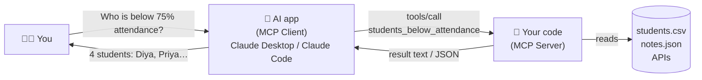

# 🎓 MCP Learner

**Learn the Model Context Protocol (MCP) by building 8 small servers — from "Hello World" to a server deployed on the internet.**

Made for B.Tech students and freshers. If you know basic JavaScript and have run `npm install` before, you're ready.

---

## 🤔 What is MCP? (2-minute version)

AI assistants like Claude are smart, but on their own they can't see your files, your database, or today's weather.
**MCP is a standard plug** that lets you give an AI new abilities by writing a small program called an **MCP server**.

> Think of it like **USB for AI**. Any USB device works with any laptop.
> Any MCP server works with any MCP app (Claude Desktop, Claude Code, Cursor, VS Code…).



An MCP server can offer the AI three kinds of things:

| Building block | What it is | Real-life analogy | First seen in |
|---|---|---|---|
| **Tool** | A function the AI is allowed to **call** | A button the AI can press | `01-calculator` |
| **Resource** | Data the app can **read** | A file the AI can open | `03-notes` |
| **Prompt** | A ready-made **message template** | A saved shortcut / macro | `04-attendance` |

And it talks to the app through a **transport**:

| Transport | How it works | When to use | Seen in |
|---|---|---|---|
| **stdio** | The app *starts your program* and talks over stdin/stdout | Local, on your own computer | `01` → `07` |
| **Streamable HTTP** | Your server runs on a URL, the app connects over HTTP | Sharing / deploying online | `08-remote-http` |

---

## 🗺️ Learning path

Do them **in order**. Each server adds only 2–3 new ideas on top of the previous one.

| # | Server | Level | You will learn | Try asking Claude |
|---|---|---|---|---|
| 01 | [calculator](servers/01-calculator) | 🟢 1 | Create server · register tools · zod schemas · stdio · error results | *"What is 37°C in Fahrenheit?"* |
| 02 | [fun](servers/02-fun) | 🟢 1 | Optional args & defaults · no-arg tools · arrays · multiple results | *"Pick 2 random students from Aarav, Diya, Rohan"* |
| 03 | [notes](servers/03-notes) | 🟡 2 | Saving state (JSON file) · full CRUD · read vs write vs destructive · **resources** | *"Save a note: use sliding window for substring problems"* |
| 04 | [attendance](servers/04-attendance) | 🟡 2 | Loading CSV data · answering questions with filter/aggregate · structured output · **prompts** | *"Which CSE students are below 75%?"* |
| 05 | [weather](servers/05-weather) | 🟠 3 | `fetch` · async/await · chaining 2 APIs · timeouts · network errors | *"Will it rain in Jaipur this week?"* |
| 06 | [github-profile](servers/06-github-profile) | 🟠 3 | API keys via env vars · headers · rate limits · insight > data dump | *"Analyze my GitHub like a recruiter: akshat1803"* |
| 07 | [placement-prep](servers/07-placement-prep) | 🔴 4 | **Capstone:** tools + resource templates + prompts + state together | *"Give me an easy arrays question"* |
| 08 | [remote-http](servers/08-remote-http) | 🔴 4 | HTTP transport · stateless servers · API-key auth · health checks · deploying | *"How many classes can I skip? I attended 42 of 50"* |
| ➕ | [scripts/try-all.ts](scripts/try-all.ts) | ⭐ | The **client** side: how an AI app connects, lists and calls tools | `npm run try` |

---

## ⚡ Quick start

**Prerequisites:** [Node.js 20.11+](https://nodejs.org) and Git.

```bash
git clone https://github.com/akshat1803/mcp-learner.git
cd mcp-learner
npm install
npm run try          # starts every server and calls its tools — see MCP working in 10 seconds
```

You should see output like:

```
━━━━━━━━ calculator (servers/01-calculator) ━━━━━━━━
  🔧 tools: add, multiply, divide, convert_units

  ▶ add({"a":2,"b":3})
    2 + 3 = 5

  ▶ divide({"a":10,"b":0})  ❌ isError
    Cannot divide by zero. Ask the user for a non-zero divisor.
```

Run just one: `npm run try -- notes`

---

## 🧪 Three ways to run a server

### 1. The test client (fastest)

```bash
npm run try -- attendance
```

### 2. MCP Inspector (see the raw JSON — best for learning!)

The Inspector is a web UI that acts like an AI app, so you can click tools yourself and see every request/response.

```bash
npm run inspect:calculator     # opens http://localhost:6274 in your browser
```

Then: **Connect → Tools → List Tools → pick `add` → fill a, b → Run Tool**.

Every server has an `inspect:` script: `inspect:fun`, `inspect:notes`, `inspect:attendance`, `inspect:weather`, `inspect:github`, `inspect:placement`.

> 💡 **Teaching tip:** Show the Inspector *before* Claude. Once students see the plain JSON going back and forth, MCP stops feeling like magic.

### 3. Inside a real AI app

#### Claude Desktop

Open **Settings → Developer → Edit Config** and paste the servers you want into `claude_desktop_config.json`.
A ready-made file is in [`claude_desktop_config.example.json`](claude_desktop_config.example.json) — just replace `/ABSOLUTE/PATH/TO` with where you cloned the repo (run `pwd` on Mac/Linux or `cd` on Windows inside the folder to get it).

```json
{
  "mcpServers": {
    "mcp-learner-calculator": {
      "command": "npx",
      "args": ["-y", "tsx", "/ABSOLUTE/PATH/TO/mcp-learner/servers/01-calculator/index.ts"]
    }
  }
}
```

Fully quit and reopen Claude Desktop. Your tools appear under the **🔨 / connectors** menu in the chat box.

> **Windows:** use paths like `C:\\Users\\you\\mcp-learner\\servers\\01-calculator\\index.ts` (double backslashes inside JSON).

#### Claude Code (terminal)

```bash
claude mcp add mcp-learner-calculator -- npx -y tsx "$(pwd)/servers/01-calculator/index.ts"
claude mcp list
```

#### Remote server (08)

```bash
npm run remote                      # http://localhost:3000/mcp
npm run try -- remote               # test it in another terminal
```

Deployed online (see [08-remote-http](servers/08-remote-http)), add its URL as a **custom connector** in Claude.

---

## 🧱 Anatomy of every server

Every file in `servers/` follows the same 3 steps. Learn this once and you can read all of them:

```ts
import { McpServer } from "@modelcontextprotocol/sdk/server/mcp.js";
import { StdioServerTransport } from "@modelcontextprotocol/sdk/server/stdio.js";
import { z } from "zod";

// 1️⃣ Create a server
const server = new McpServer({ name: "calculator", version: "1.0.0" });

// 2️⃣ Register tools
server.registerTool(
  "add",                                         // name the AI calls
  {
    description: "Add two numbers together.",    // WHEN to use it  (the AI reads this!)
    inputSchema: { a: z.number(), b: z.number() } // WHAT to send   (validated by zod)
  },
  async ({ a, b }) => ({                         // your code
    content: [{ type: "text", text: `${a + b}` }],
  })
);

// 3️⃣ Connect a transport
await server.connect(new StdioServerTransport());
```

---

## 📏 Golden rules (learn these, avoid 90% of bugs)

1. **Never `console.log` in a stdio server.** stdout carries the MCP messages; printing to it corrupts them. Use `console.error` for logs.
2. **The description is the most important line.** If it's vague, the AI won't call your tool (or will call it at the wrong time). Write it like you're explaining to a new teammate.
3. **Don't crash — return `isError: true`** with a helpful message. The AI reads it and can recover or explain.
4. **Return insight, not a data dump.** `analyze_profile` returns 5 lines, not 100 raw repos. Less text = better AI answers.
5. **Separate read and write tools**, and mark them (`readOnlyHint`, `destructiveHint`) so apps can ask the user before risky actions.
6. **Secrets go in environment variables**, never in code or Git (`GITHUB_TOKEN`, `MCP_API_KEY`).
7. **Every network call needs a timeout.** A hanging API should never freeze the AI.

---

## 📂 Project structure

```
mcp-learner/
├── servers/
│   ├── 01-calculator/        index.ts
│   ├── 02-fun/               index.ts
│   ├── 03-notes/             index.ts   (+ notes.json created at runtime)
│   ├── 04-attendance/        index.ts   students.csv
│   ├── 05-weather/           index.ts
│   ├── 06-github-profile/    index.ts
│   ├── 07-placement-prep/    index.ts   questions.json  (+ progress.json at runtime)
│   └── 08-remote-http/       index.ts
├── scripts/try-all.ts        ← an MCP client that tests every server
├── claude_desktop_config.example.json
├── package.json              ← one script per server
└── tsconfig.json
```

Each server folder has its own **README** with: what's new, a tool table, what to ask Claude, and **exercises**.

---

## 🏫 Suggested course plan (for instructors)

| Session | Duration | Cover | Homework |
|---|---|---|---|
| 1 | 1.5 h | What is MCP · install · `npm run try` · Inspector · **01 calculator** | Exercises in 01 |
| 2 | 1.5 h | **02 fun** · connect to Claude Desktop · why descriptions matter | Add 2 tools to 02 |
| 3 | 2 h | **03 notes** · state, CRUD, resources | Exercises in 03 |
| 4 | 2 h | **04 attendance** · data questions, structured output, prompts | Add your own CSV |
| 5 | 2 h | **05 weather** + **06 github** · APIs, env vars, errors | Build a server for any free API |
| 6 | 2 h | **07 placement-prep** · read the capstone end-to-end | Add 10 questions + a new tool |
| 7 | 2 h | **08 remote-http** · deploy to Render/Railway · demo day | Final project (ideas below) |

### 💡 Final project ideas

- 🚆 **Train/PNR status** (using a public API) · 📚 **Library book tracker** · 🍛 **Mess menu of the week**
- 🧾 **Expense splitter** for hostel roommates · 📅 **Exam timetable + countdown** · 🏏 **Cricket score** server
- 🗂️ **Your own college project's backend** exposed as MCP tools

---

## 🛠️ Troubleshooting

| Problem | Fix |
|---|---|
| Tools don't show up in Claude Desktop | Use an **absolute path**, check the JSON is valid, then **fully quit** Claude (not just close the window). Logs: Settings → Developer → *Open Logs Folder*. |
| `Unexpected token` / weird JSON errors | Something is printing to stdout. Replace `console.log` with `console.error`. |
| `npx: command not found` in Claude Desktop | Claude can't see your PATH. Use the full path to `npx` (`which npx` / `where npx`). |
| Weather says `fetch failed` | No internet, or a firewall/proxy is blocking `open-meteo.com`. |
| GitHub says rate limit | Anonymous limit is 60 req/hour. Create a token and set `GITHUB_TOKEN` (see 06 README). |
| `ERR_UNKNOWN_FILE_EXTENSION .ts` | Run with `tsx`, not plain `node` (the npm scripts already do this). |

---

## 📖 Learn more

- MCP documentation: https://modelcontextprotocol.io
- TypeScript SDK: https://github.com/modelcontextprotocol/typescript-sdk
- MCP Inspector: https://github.com/modelcontextprotocol/inspector

---

Made with ❤️ for students by [Akshat Sharma](https://github.com/akshat1803) · MIT License
