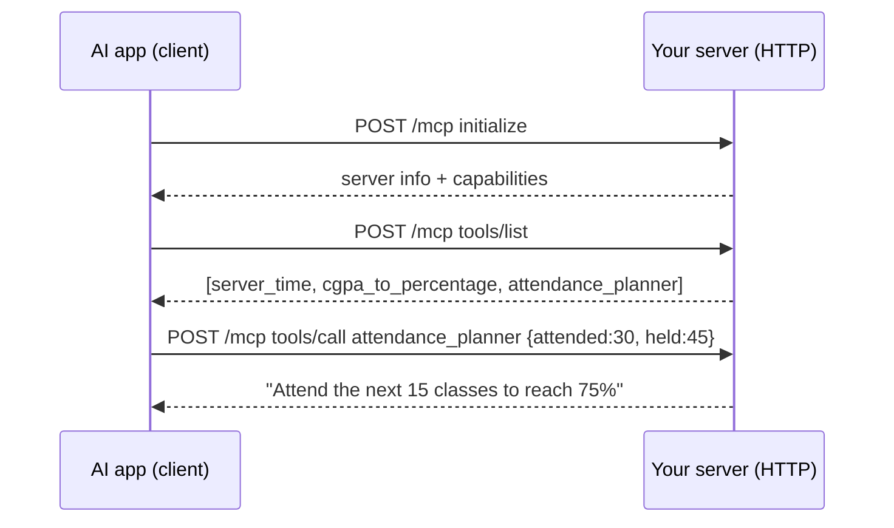

# 08 · Remote MCP over HTTP 🔴

Servers 01–07 run **on your laptop** (the app starts them). This one runs **on a URL**, so you can deploy it and share it with your whole class.

## 🆕 What you'll learn
- **Streamable HTTP transport**: clients send JSON-RPC as `POST /mcp`
- **Stateless mode** (`sessionIdGenerator: undefined`): a fresh server per request — simple and easy to scale
- **API-key auth** with `Authorization: Bearer <key>`
- A **`/health`** endpoint for hosting platforms



## 🔧 Tools
| Tool | Input | Example |
|---|---|---|
| `server_time` | – | Current IST time on the server |
| `cgpa_to_percentage` | `cgpa`, `multiplier?` (9.5) | `8.4 → 79.80%` |
| `attendance_planner` | `attended`, `held`, `target?` (75) | "Attend next 15" / "You can skip 6" |

## ▶️ Run locally
```bash
npm run remote                          # http://localhost:3000/mcp
npm run try -- remote                   # in a second terminal
```
With auth:
```bash
MCP_API_KEY=mysecret npm run remote
MCP_API_KEY=mysecret npm run try -- remote
```
Inspector: `npx @modelcontextprotocol/inspector` → Transport **Streamable HTTP** → URL `http://localhost:3000/mcp`.

## 🚀 Deploy (Render example, free tier)
1. Push this repo to GitHub.
2. Render → **New → Web Service** → pick the repo.
3. Build command: `npm install` · Start command: `npm run remote`
4. (Optional) Environment → add `MCP_API_KEY`.
5. Your server is at `https://<your-app>.onrender.com/mcp`. Check `/health` in the browser.

Railway, Fly.io or any VPS work the same way: install, then `npm run remote`. The `PORT` env var is respected.

**Connect it to Claude:** Settings → Connectors → **Add custom connector** → paste the `/mcp` URL.

> ⚠️ A simple API key is fine for learning. Claude's custom connectors expect **OAuth** for authenticated servers, so for a public connector either leave it without auth (only harmless tools!) or implement OAuth — see the [MCP authorization docs](https://modelcontextprotocol.io/specification/latest/basic/authorization).

## 🏋️ Exercises
1. Move `03-notes` tools into this HTTP server. What problem appears when **many users** share one `notes.json`?
2. Add a `exam_countdown(examDate)` tool.
3. Switch to **stateful mode** (`sessionIdGenerator: () => randomUUID()`) — see the SDK README. When would you need sessions?
4. 🧠 Deploy it and connect your phone's Claude app to it. 🎉
